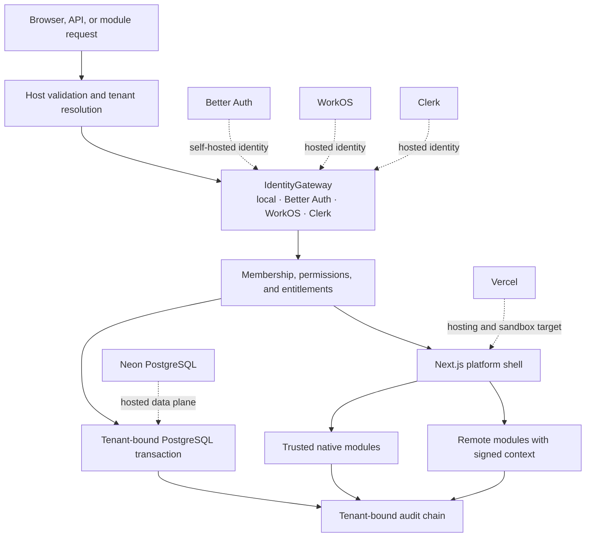

<p align="center">
  
</p>

<h1 align="center">OpenTenant</h1>

<p align="center">
  <strong>The reusable foundation for secure, modular, multi-tenant applications.</strong>
</p>

<p align="center">
  Tenant boundaries, provider choice, isolated modules, and auditable operations—without rebuilding the same platform plumbing for every product.
</p>

<p align="center">
  
  
  
  
</p>

<p align="center">
  <a href="#why-opentenant">Why OpenTenant</a> ·
  <a href="#platform-at-a-glance">Architecture</a> ·
  <a href="#capability-map">Capabilities</a> ·
  <a href="#run-it-locally">Quick start</a> ·
  <a href="#documentation">Documentation</a> ·
  <a href="CHANGELOG.md">Changelog</a>
</p>

---

OpenTenant is a local-first TypeScript platform for teams building SaaS,
internal tools, data workflows, and AI-assisted applications that must safely
serve more than one organization.

It turns the difficult, security-sensitive parts of multi-tenancy—trusted
tenant resolution, identity binding, database isolation, permissions, branding,
module execution, credentials, and audit evidence—into reusable contracts.
Application teams can spend their time on the workflows that make their
product distinctive.

> [!IMPORTANT]
> **OpenTenant is in pre-1.0 development.** The core platform and local
> verification suite are implemented, and bounded provider integrations have
> been exercised in development-only environments. It has not been approved
> for production or genuine tenant data.

## What's new

- **Bring an existing brand into a tenant.** Tenant administrators can upload a
  `brand.md` file, see where each supported suggestion came from, edit draft
  values, and apply only the values that tenant policy leaves unlocked.
  Replacing an existing draft also requires separate supersede permission.
- **Keep Assessment AI inside tenant policy.** Optional executive readouts now
  use the model route approved for that tenant. A browser request cannot choose
  its own provider or borrow an ambient application key.
- **Pick up an Assessment where you left off.** A restorable engagement backup
  keeps client details, scores, notes, respondents, progress, and the current AI
  readout. An invalid backup leaves the work already on screen untouched.
- **Move between tenants without guessing the URL.** Signed-in users can open a
  tenant launcher that shows only their active memberships and verified
  OpenTenant domains.
- **Review recent tenant activity without exposing raw audit records.** Tenant
  administrators see only the admin-safe fields for their active tenant. Raw
  audit records stay hidden.

## Why OpenTenant

| | |
|---|---|
| **Start with a real tenant boundary**<br>Every request resolves to one trusted tenant before identity, data, or module access. Missing or contradictory context fails closed. | **Choose identity without rewriting the app**<br>One installation uses Better Auth, WorkOS or Clerk behind the same internal session, organization, membership, and permission model. |
| **Keep modules useful—not privileged**<br>Native and remote modules consume stable manifests and short-lived signed context without receiving control-plane credentials. | **Make sensitive changes explainable**<br>Privileged state, encrypted credentials, and append-only audit evidence have explicit ownership and verification rules. |

OpenTenant is designed for teams that want a reusable application foundation,
not another hosted black box. It runs locally without cloud accounts, keeps
provider SDKs at adapter boundaries, and leaves room for future providers
without pretending they are already supported.

## Platform at a glance



The provider products are deployment choices, not the domain model. Internal
tenant, user, membership, permission, module, and audit identifiers remain
stable even when an adapter changes.

## Capability map

| Capability | What it gives a product team | Current state |
|---|---|---|
| **Tenant resolution** | One trusted tenant context for every request; malformed and unknown hosts reveal nothing | Implemented |
| **Identity and membership** | One internal session model backed by Better Auth, WorkOS or Clerk per installation | Implemented; Better Auth locally verified, WorkOS end-to-end and Clerk setup verified |
| **Tenant data isolation** | Tenant-specific PostgreSQL data planes, forced row-level security, and encrypted connection records | Implemented; Neon development-verified and self-hosted Postgres locally tested |
| **Branding and administration** | Tenant-safe brand settings, member administration, module entitlements, and navigation | Implemented |
| **Native and remote modules** | Stable manifests and short-lived signed context without platform credentials | Implemented core; publication not exposed |
| **Brokered module data** | Version-bound, revocable capabilities that expose fixed tenant operations instead of database credentials | First capability implemented: content-minimized support summaries |
| **Audit and secrets** | Tenant-bound append-only audit chains, a redacted recent-activity view for tenant admins, credential encryption, and secret-safe provider errors | Implemented |
| **Admission and exact usage** | Shared PostgreSQL admission limits plus immutable, tenant-scoped usage evidence kept separate from billing policy | Implemented; commercial policy owner-gated |
| **Developer MCP and sandboxes** | Tenant-authorized workspace creation, human confirmation and a static preview after VM teardown | Real local route proof; production disabled behind OWNER-DEVELOPER-MCP-02 |
| **Tenant module UI starter** | Apache-licensed Next.js, Tailwind v4, semantic brand tokens, and official shadcn/ui primitives | Implemented source starter; MCP scaffolding not exposed |
| **Operations** | Local PostgreSQL, canonical migrations, resumable provisioning, health, recovery, and deployment runbooks | Implemented local core |

The [platform capabilities guide](docs/product/platform-capabilities.md)
explains the status language, exact behavior, provider evidence, and remaining
production gates.

## Provider model

An installation chooses providers at deployment time. Identity providers are
not mixed between tenants in the same installation.

| Concern | Shipped choice | Contract and limits |
|---|---|---|
| **Local identity** | Built-in single-user or `LOCAL_USERS` adapter | Development only; per-token tenant binding; rejected in production |
| **Self-hosted identity** | Better Auth, MIT | Email/password behind `IdentityGateway`; optional SSO/SCIM require operator configuration and external proof. Mail transport is injected. [Runbook](docs/architecture/better-auth-adapter.md) |
| **Hosted identity** | WorkOS **or** Clerk | One provider per installation behind `IdentityGateway` |
| **Tenant databases** | Neon or operator-owned PostgreSQL | Select `PROVISIONING_PROVIDER`; per-tenant databases, restricted runtime roles, canonical migrations and encrypted connection records. Postgres region labels declare operator placement. |
| **Application hosting** | Vercel | Account, team, project, region, and domain remain runtime configuration |
| **Sandbox adapters** | E2B or local microsandbox | Local Docker/KVM provider and Developer MCP route proofs exist with a cached digest-pinned image; hosted execution remains owner-gated |
| **Operator diagnostics** | Optional Vercel MCP | Human-confirmed diagnostics, separate from OpenTenant's Developer MCP |
| **Model readouts** | Optional OpenAI-compatible and Anthropic-compatible chat; OpenAI-compatible embeddings | Wave-5 R5 adapters and typed host composition exist, with synthetic HTTP verification only. No live model-provider validation is recorded. Unconfigured production is unavailable, with no synthetic fallback. Vercel AI Gateway has no separate proven adapter. [Configuration and limits](docs/adopters/wave5-ai-wiring.md) |

Other providers can be added by implementing the same narrow contracts. A
Supabase-backed PostgreSQL adapter is a plausible future option, for example,
but it is **not implemented or supported today**.

## Modules included as examples

The repository includes three synthetic modules that prove different platform
contracts. They are examples, not OpenTenant's product identity.

| Module | Surface | What it demonstrates |
|---|---|---|
| **Assessment** | `/assessment` | Branded native UI, deterministic scoring, browser-local state, exports, access modes, and optional streamed model readouts |
| **Knowledge** | `/brain` and `/api/mcp/brain` | Browser unavailable state and a separate signed knowledge API; local token hashing does not prove hosted semantic search or composed browser search tools |
| **Support** | `/support` and `/support/:id` | Ticket workflows, durable email and human-reviewed suggestions; routed AI generation remains unavailable pending provenance and quarantine dependencies |

Replace them, extend them, or use them as reference implementations for your
own modules.

## Developer MCP and isolated development

OpenTenant's planned Developer MCP lets an authorized tenant developer—or a
delegated coding agent—work on tenant-private remote modules without receiving
ambient platform credentials.

The repository already contains:

- exact WorkOS token verification and active tenant binding for the first
  authentication prerequisite;
- frozen permission profiles, modern MCP `2026-07-28` discovery/tool-list
  contracts, per-call authorization, and atomic append-only decision audit;
- fail-closed workspace path, command, resource, network, and preview policy;
- in-memory conformance tests plus sandboxd and injected Vercel boundaries;
- immutable, digest-verified server-owned templates;
- an Apache-licensed shadcn-ready Next.js tenant-module UI starter;
- bounded install, build, test, preview, evidence, and teardown orchestration;
  and
- authenticated preview mediation with normalized, secret-safe errors.

The local `/api/mcp/developer` route has a
[real route proof](docs/reviews/2026-11-17-developer-mcp-route.json) covering
OAuth/PKCE, tenant authority, explicit human confirmation, VM execution and
destruction, a single-use static preview, and negative controls. This is separate
from the earlier sandbox-provider lifecycle proof. Production remains disabled
behind OWNER-DEVELOPER-MCP-02; no deployed route or module publication is approved.

This is distinct from [Vercel's operator MCP](docs/runbooks/vercel-operator-mcp.md),
which is an optional human-operated diagnostic surface for deployments and
logs. It does not receive tenant authority or replace OpenTenant's Developer
MCP.

The [tenant module UI toolkit](docs/product/module-ui.md) explains why the
reusable builder uses only official shadcn/ui and OpenTenant-reviewed material,
while licensed Shadcn Studio assets remain in a separately released marketing
end product.

## Security by construction

OpenTenant treats caller-controlled headers, tenant content, generated code,
provider responses, traces, and web content as hostile.

- **Tenant binding first:** trusted host resolution precedes identity, data,
  and module access.
- **Fail-closed data access:** the committed V1 proof executes 406 isolation
  checks across 41 tenant tables with enabled and forced row-level security.
- **Stable internal identity:** provider organization and user identifiers stop
  at provider-bound mapping stores.
- **No ambient module credentials:** remote modules get an expiring,
  module-bound Ed25519 context and a public verification key.
- **Authenticated encryption:** connection and OAuth credentials are encrypted
  with tenant/provider context as authenticated data.
- **Honest audit assurance:** verification distinguishes canonical,
  legacy-but-valid, empty, and unverified history without rewriting old events.
- **Isolated generated code:** sandbox policy requires bounded commands,
  deny-by-default egress, authenticated previews, and deterministic teardown.

Read the [accepted architecture](docs/architecture/platform-architecture.md)
and [Developer MCP threat model](docs/security/developer-mcp-threat-model.md)
for the complete boundaries.

## Run it locally

### Prerequisites

- Node.js `22.23.2` or later within major 22
- pnpm `11.13.1`
- Docker with Compose support

### Setup

Run these commands from the repository root. See the
[developer workspace guide](docs/tooling/local-workspace.md) for local files and hooks.

```bash
test -f .env || cp .env.example .env
pnpm install --frozen-lockfile
pnpm local:setup
pnpm dev
```

Open <http://localhost:3000>. The example environment uses a synthetic local
tenant and the non-production local identity adapter. WorkOS, Clerk, Neon,
Vercel, and model-provider credentials are optional for normal local
development.

Useful local surfaces:

- `/` — tenant-aware platform home;
- `/assessment` — example assessment module;
- `/support` — example support workflow; and
- `/settings` — tenant branding, identity, members, modules, navigation, and
  connections.

### Verify the repository

The [delivery contract](docs/DELIVERY.md) lists the additional audit, database,
and browser evidence required for changes that affect those surfaces.

```bash
pnpm check
pnpm build
```

For the exhaustive live PostgreSQL isolation proof, follow the commands in the
[current handoff](docs/HANDOFF.md).

## Repository map

```text
OpenTenant/
├── apps/platform/          Next.js shell, routes, and provider composition
├── modules/
│   ├── assessment/         Native assessment example
│   ├── brain/              Knowledge and retrieval example
│   └── support/            Tenant support workflow example
├── packages/
│   ├── auth/               Local, WorkOS, and Clerk identity adapters
│   ├── auth-better-auth/   Self-hosted Better Auth identity adapter
│   ├── database/           Tenant locators, stores, encryption, and audit
│   ├── module-sdk/         Permissively licensed remote-module contract
│   ├── platform-core/      Tenant, brand, module, and navigation domain types
│   ├── sandbox/            Isolated workspace policy and adapters
│   └── security/           Passcodes, canonical JSON, and signed context
├── tooling/
│   ├── migrations/         Canonical control- and tenant-plane migrations
│   ├── provisioning/       Provider-neutral provisioning, Neon and Postgres adapters
│   └── ci/                 Live PostgreSQL RLS proof
├── templates/
│   └── tenant-module-nextjs/ Apache-licensed shadcn-ready UI starter
├── docs/                   Architecture, product, security, plans, and runbooks
└── .local/                Ignored development workspace
```

Provider SDK imports stay in adapters or the Next.js composition root. Modules
do not import the control plane, identity provider, deployment provider, or
tenant database credentials.

## Verification snapshot

The [E11 receipt ledger](docs/plans/2026-11-17-e11-reconciliation.md) records
the source revision and limits of each result. These are committed local
receipts, not a fresh wave-7 run:

| Gate | Result |
|---|---:|
| V1 monorepo lint, typecheck, and test tasks | 115 / 115 passed |
| V1 database sequence | 17 steps, 358 cases, zero skips |
| V1 live PostgreSQL RLS proof | 406 checks / 41 tables |
| V1 full migration suite | 178 passed, zero failures/skips |
| E2E collection at `d818389`, execution counted separately | legacy 16 / journeys 41 / reset 24 / audit 702 |
| Built production no-regression proof | 6 / 6 passed; Assessment LCP/CLS targets still missed |
| Developer MCP package proof | 141 passed, zero skips |

GitHub Actions is billing-blocked, so these waves have no hosted CI receipts.
Runner KVM proof remains owner-gated by OWNER-KVM-CI-01. Static-page generation
counts do not measure the module routes composed through manifests.
UAT-015 stays open. The wave-7 BrowserOS UAT run
([Q1 r1](docs/reviews/uat-2026-11-17/q1-findings-r1.md)) did not pass: 4 pass,
2 fail and 24 blocked of 30 journey-width checks, with no P0 or P1. Its failure
(UAT-020) and fixture blocks are fixed in wave 7 but not yet re-run. ECS is
**4.25** ([receipt](docs/reviews/2026-11-17-ecs-wave7.md)).

## Roadmap and maturity

### Available now

- Local-first tenant shell, administration, example modules, migrations, and
  deterministic tests.
- WorkOS and Clerk deployment adapters behind one identity contract.
- Neon provisioning and tenant-isolation path verified in a development-only
  environment.
- Native/remote module contracts, signed context, audit chains, encrypted
  credentials, and sandbox foundations.
- A route-independent Developer MCP authority package with frozen permissions,
  profiles, bounded non-callable descriptors, revocation rules, deterministic
  discovery data, and a closed audit vocabulary.
- A dependency-free modern MCP `2026-07-28` protocol contract for exact request
  and header validation, tenant-invariant server discovery, and private
  authority-filtered tool-list serialization, composed into the locally proven
  `workspace.create` route. Production activation remains owner-gated.
- A named route-independent per-call Developer MCP authorization gate with
  60-second raw-authority freshness, revocation-before-resource ordering,
  live high-risk revalidation, and an immutable provider-neutral local
  resource-authorization reference adapter.
- A tenant-admin recent-activity page that reads only the verified active
  tenant, projects a default-deny action and metadata allowlist, and exposes no
  raw audit detail or caller-selected tenant filter.
- A signed-in tenant launcher that derives cards only from the current user's
  active memberships, active tenant records, and verified OpenTenant
  subdomains, then binds the selected tenant through the existing host
  resolver without accepting caller-supplied tenant selectors.
- A local-first unattended-development runner that selects one approved task at
  a time from a durable backlog and independently enforces scope, checkpoint,
  and verification gates.
- Atomic PostgreSQL admission and idempotency enforcement shared by the
  assessment readout, telemetry, and module-access routes, replacing their
  process-local counters. Replays never repeat route side effects, malformed
  caller keys remain 400-class input errors, leases release on every terminal
  path, and streamed provider work is cancelled at the persisted lease deadline.
- Append-only exact usage evidence with server-owned metric definitions,
  complete immutable-identity replay checks, tenant/metric isolation, immutable
  same-occurrence corrections, and bounded half-open aggregation. It contains no
  price, plan, entitlement, invoice, checkout, or payment-provider policy.

### Autonomous backlog status

- The legacy governed backlog records **53 completed non-owner tasks** and
  four pending owner entries. Its empty controller queue does not imply the
  later UX wave backlog is complete.
- The machine-readable evidence and stop conditions remain in
  [unattended development](docs/tooling/unattended-development.md). New local
  work should be added only through a reviewed backlog contract, not inferred
  from an owner gate.

### Four pending controller owner gates

- `OWNER-SLACK-01`: nominate and approve the development-only Slack probe.
- `OWNER-DEVELOPER-MCP-02`: approve production activation of the exact locally
  proven Developer MCP route and its launch evidence.
- `OWNER-COMPLIANCE-01`: select the SOC 2 and Vanta programme boundary.
- `OWNER-BILLING-01`: freeze billable metrics, commercial semantics, replay
  policy, and payment-provider scope.

Production identity, data, restore, incident, sandbox and public-release
approvals remain separate gates. OWNER-KVM-CI-01 requires hosted runner proof;
engineering work also remains in the later UX waves.

### Later

- Developer MCP tools beyond the locally proven synthetic `workspace.create`
  path, followed by separately governed module publication.
- Provider-neutral plan entitlements and payment-provider integration after
  usage metrics, replay policy, and commercial semantics are owner-approved.
- Additional brokered tenant capabilities added one reviewed operation at a time; the first content-minimized support-summary read is implemented.
- Additional provider adapters—such as a separately implemented and verified
  Supabase PostgreSQL option—where adopter demand justifies them.
- Module Improvement Lab observation and proposal workflows after privacy and
  quality-contract gates exist.

See [OWNER-TASKS.md](docs/OWNER-TASKS.md) for the exact decision queue. Nothing
in this roadmap authorizes production resources, genuine tenant data, or
automatic publication.

## Documentation

Start with the [adopter guides](docs/adopters/README.md) for setup, concepts,
provider choices, operations, security and FAQ.

| Document | Use it for |
|---|---|
| [Platform capabilities](docs/product/platform-capabilities.md) | Feature maturity, human outcomes, provider choices, and limits |
| [Changelog](CHANGELOG.md) | The product story across development iterations |
| [Architecture](docs/architecture/platform-architecture.md) | Accepted system boundaries and request lifecycle |
| [Interactive runtime architecture](docs/tooling/archify.md#worked-example) | Source-backed Archify diagram with guided views and local HTML artifact |
| [Developer MCP requirements](docs/product/developer-mcp.md) | Planned tenant module-development product behavior |
| [Threat model](docs/security/developer-mcp-threat-model.md) | Security objectives, assets, threats, and launch gates |
| [Documentation index](docs/README.md) | All architecture, product, operational, legal, and planning records |
| [Ship log](docs/SHIPLOG.md) | Detailed delivered capabilities and evidence |
| [Current handoff](docs/HANDOFF.md) | Exact branch, verification, blockers, and next step |
| [Owner tasks](docs/OWNER-TASKS.md) | Decisions and external actions code cannot complete |
| [Knowledge graph guide](docs/tooling/knowledge-graph.md) | Querying the local Graphify architecture map |
| [Archify diagrams](docs/tooling/archify.md) | Creating and checking standalone architecture diagrams |
| [Unattended development](docs/tooling/unattended-development.md) | Research basis, task queue, safety gates, commands, and hosted-automation boundary |

## Licensing and publication

OpenTenant uses a split licence model:

- **Core platform and native code:** `AGPL-3.0-only`
- **Remote module SDK and tenant UI starter:** `Apache-2.0`
- **Documentation:** `CC-BY-SA-4.0`
- **OpenTenant names and branding:** separately reserved

Read [LICENSING.md](LICENSING.md), [TRADEMARKS.md](TRADEMARKS.md), and
[COMMERCIAL-LICENSE.md](COMMERCIAL-LICENSE.md) before redistributing or
offering a hosted modification.

The technical licence and provenance review is complete for the current
development closure. Legal-steward, rights-attestation, artifact-specific,
trademark, security-disclosure, and counsel approvals still block public
release. External contributions are not currently accepted.
