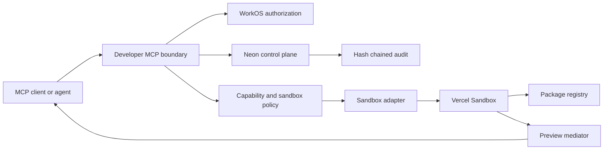

# Developer MCP threat model

Status: Phase 0 baseline

Date: 2026-07-20

## Executive summary

The highest-risk future paths are confused-deputy authorization, cross-tenant
sandbox attachment, sandbox escape or credential exfiltration, and an
unauthenticated preview or publication path. The repository already has strong
building blocks—exact WorkOS JWT audience validation, explicit active tenant
binding, bounded sandbox policy, authenticated-preview mediation, normalized
provider errors, deterministic teardown, and hash-chained audit—but no
`/api/mcp/developer` route exists yet. This model therefore records the gates
that must be present before the first successful Developer MCP tool call.

## Scope and assumptions

In scope:

- Developer MCP identity and tenant binding in `packages/auth`;
- sandbox contracts, policy, adapters, and lifecycle proof in
  `packages/sandbox`;
- the planned Next.js Developer MCP composition boundary in `apps/platform`;
- control-plane tenant mapping and audit evidence in `packages/database`; and
- supply-chain and preview controls required by the Developer MCP PRD.

Out of scope: the Brain MCP's content model, existing example-module business
logic, genuine tenant data, production provider configuration, Module
Improvement Lab experiments, and provider account compromise. Publication and
brokered capabilities are included only as future boundary gates.

Assumptions:

- Hosted operation targets WorkOS or Clerk for installation-level identity,
  Vercel for hosting/sandbox execution, and Neon for PostgreSQL data planes,
  while account IDs and credentials remain runtime configuration
  (`docs/architecture/platform-architecture.md`, section 17).
- The current Developer MCP token-verification implementation is WorkOS-only.
  Clerk browser identity support does not imply a successful Clerk Developer
  MCP route; that verifier remains a separate gated slice.
- The Developer MCP and authenticated previews will be internet-reachable, but
  no successful Developer MCP route or hosted sandbox is active today
  (`docs/HANDOFF.md`; `apps/platform/app/api/mcp/`).
- Development uses synthetic data. Genuine data and raw credentials remain
  unavailable to sandboxes until separate owner gates pass
  (`docs/OWNER-TASKS.md`; `packages/sandbox/src/orchestrator.ts`).
- The MCP client, user prompts, generated source, dependencies, tool inputs,
  provider responses, and sandbox output are hostile.
- The first route targets stable MCP `2026-07-28`. Its stateless request
  `_meta`, standard routing headers, and discovery/cache inputs are hostile and
  do not establish client identity, tenant identity, or authority.
- This unattended baseline could not pause for context validation. Open
  questions are recorded below and in `docs/OWNER-TASKS.md`.

Open questions that materially change risk:

- Which stable provider group identifiers map to the already frozen builder
  profiles?
- What concurrency, duration, spend, egress, region, retention, and deletion
  limits pass the Vercel Sandbox production probe?
- Which publication actions require a different human approver, and which
  tenant data/API capabilities are ever enabled?

## System model

### Primary components

- **MCP client or coding agent:** in the current planned first route, obtains a
  resource-specific WorkOS token and submits hostile tool inputs and source.
  Any future Clerk route must satisfy the same normalized contract and threat
  controls.
- **Platform MCP composition boundary:** planned Next.js route that must resolve
  the trusted host tenant before authentication, policy, audit, and tools. It
  does not exist yet (`docs/product/developer-mcp.md`,
  FR-001/FR-002).
- **Authentication and tenant binding:** verifies exact issuer, signature,
  single audience, expiry, subject, organisation, delegation, impersonation,
  membership status, and expected tenant (`packages/auth/src/developer-mcp.ts`;
  `packages/auth/src/workos/developer-mcp.ts`).
- **Control plane and audit:** maps external organisations to internal tenants
  and stores append-only hash chains. The generic store does not validate or
  redact caller-supplied event fields; a Developer MCP audit schema is still a
  required composition-boundary control (`packages/database/src/control-plane-stores.ts`;
  `packages/database/src/audit-store.ts`).
- **Policy and orchestration:** validates workspace paths, limits, network,
  commands, previews, artifacts, and cleanup (`packages/sandbox/src/policy.ts`;
  `packages/sandbox/src/orchestrator.ts`).
- **Vercel Sandbox adapter and preview mediator:** runs untrusted work and must
  return a different authenticated HTTPS preview origin
  (`packages/sandbox/src/providers/vercel/adapter.ts`).

### Data flows and trust boundaries

- Internet client → platform MCP: bearer JWT, JSON-RPC/tool payloads, source,
  and resource IDs over HTTPS. Required guarantees: size/rate limits, strict
  schemas, exact OAuth resource challenge, no token forwarding, exact
  `Mcp-Method`/`Mcp-Name` agreement with the body, and request-scoped authority.
  Permission-filtered lists are private and cache for at most 60 seconds. The
  JWT and tenant-binding library exists; the route, schemas, and quotas do not.
- Platform MCP → WorkOS/JWKS: public signing keys and, for high-risk future
  calls, revocation decisions over HTTPS. Signature, issuer, exact single
  audience, expiry, `sub`, and `org_id` validation exist locally
  (`WorkOSDeveloperMcpTokenVerifier`).
- Platform MCP → Neon control plane: external organisation/subject binding,
  workspace state, policy decisions, and audit records over PostgreSQL. The
  existing stores use parameterized queries and internal IDs; the Developer
  MCP binding resolver and workspace schema are not implemented.
- Platform MCP → SandboxAdapter: internal tenant/workspace IDs, approved
  template, files, structured commands, hard limits, and deny-by-default
  network policy. Validation is centralized in `packages/sandbox/src/policy.ts`.
- Sandbox adapter → Vercel: provider requests and hostile process output.
  Provider errors are normalized; response URLs require credential-free HTTPS
  form (`packages/sandbox/src/providers/vercel/adapter.ts`, `providerError` and
  `safeHttpsUrl`).
- Sandbox → preview mediator → user: hostile web content through an
  authenticated, tenant/workspace-bound, expiring URL. The adapter fails when
  the protected origin equals the raw provider origin.
- Platform MCP → audit store: the planned Developer MCP audit contract must
  allowlist content-free actor, tenant, action, subject, and decision fields.
  The current generic store serializes arbitrary caller values, then
  serializes appends per scope and hash-chains them; it does not enforce
  classification or redaction (`PgAuditStore.appendWithClient`).

#### Diagram

## Assets and security objectives

| Asset | Why it matters | Security objective |
|---|---|---|
| Tenant identity and membership | Determines every downstream tenant boundary | C, I |
| WorkOS access tokens and provider credentials | Theft enables impersonation or provider control | C, I |
| Tenant module source and artifacts | May contain proprietary logic and executable supply-chain input | C, I |
| Sandbox compute and network policy | Escape or policy bypass reaches platform/provider assets | C, I, A |
| Preview sessions and URLs | A preview executes hostile UI and may expose tenant branding/context | C, I |
| Control-plane workspace and capability state | Drives ownership, quotas, approval, and revocation | I, A |
| Audit and validation evidence | Publication and incident decisions depend on its integrity | I, A |
| Provider spend and availability | Unbounded jobs can create financial and service denial | A |

## Attacker model

### Capabilities

- An unauthenticated internet client can send malformed tokens and protocol
  requests to the future public endpoint.
- A malicious tenant member or compromised MCP client can hold a valid token,
  guess IDs, race revocation, and submit hostile source, dependency manifests,
  command arguments, paths, logs, and preview content.
- A generated module or dependency can attempt filesystem traversal, resource
  exhaustion, metadata access, outbound exfiltration, misleading test output,
  and persistence through snapshots or artifacts.
- A tenant administrator may legitimately assign some roles but must not grant
  themselves platform or another tenant's authority.

### Non-capabilities

- The attacker does not begin with Vercel, WorkOS, Neon, signing-key, or
  control-plane credentials.
- The attacker cannot directly mutate the checked-in approved template or
  platform code without a separate source-control compromise.
- Genuine tenant data, raw secrets, unrestricted shell, publication, and
  infrastructure application are not capabilities of the current phase.

## Entry points and attack surfaces

| Surface | How reached | Trust boundary | Notes | Evidence |
|---|---|---|---|---|
| Planned Developer MCP route | Internet HTTPS | Client → platform | No route exists; metadata, schemas, and quotas remain gates | Developer MCP PRD FR-001/FR-002 |
| WorkOS bearer token | Authorization header | WorkOS/client → auth | Exact single audience and active tenant binding; delegated/impersonated identities denied | `packages/auth/src/developer-mcp.ts`; `packages/auth/src/workos/developer-mcp.ts` |
| Workspace create/write/command | MCP tools | Platform → sandbox | IDs must be server-derived; paths, limits, network, and commands are bounded | `packages/sandbox/src/contracts.ts`; `policy.ts` |
| Dependency install/build/test | Fixed structured commands | Sandbox → package ecosystem | Offline frozen-lockfile proof exists; production package policy is incomplete | `packages/sandbox/src/orchestrator.ts` |
| Preview | Authenticated URL | Sandbox/provider → browser | HTTPS, expiry, different protected origin required | `packages/sandbox/src/providers/vercel/adapter.ts` |
| Logs and artifacts | Tool results | Sandbox → platform/client | Output and artifact bytes are bounded; content redaction policy is incomplete | `packages/sandbox/src/policy.ts`; `orchestrator.ts` |
| Provider client/errors | Adapter calls | Platform → provider | Typed normalization drops raw provider error details | `packages/sandbox/src/errors.ts`; Vercel `adapter.ts` |
| Audit append/read | PostgreSQL | Platform → control plane | Per-scope lock and hash chain; field allowlist/redaction and tool-call transaction integration are pending | `packages/database/src/audit-store.ts` |
| CI and approved template | Git/pnpm | Developer → build | Lockfile and CI gates exist; source-control compromise is a separate threat | `.github/workflows/ci.yml`; `packages/sandbox/src/template.ts` |

## Top abuse paths

1. Attacker obtains a token for another API → presents it to Developer MCP →
   server accepts a broad/multi audience → attacker reaches code execution.
2. Tenant A submits tenant B's workspace/checkpoint ID → a caller-supplied ID
   reaches `SandboxAdapter` → attacker reads, restores, or runs B's source.
3. Generated code or a dependency starts in the sandbox → exploits excessive
   egress, metadata access, or provider isolation → exfiltrates a credential or
   pivots toward control-plane infrastructure.
4. Malicious lockfile/package/install script enters validation → dependency
   execution tampers with build evidence → a compromised artifact appears
   publishable.
5. Attacker learns a raw preview origin → bypasses mediator authentication or
   reuses access after termination → serves hostile content outside tenant and
   expiry checks.
6. Source or process output embeds a secret → logs, provider errors, artifacts,
   or MCP responses return it → credentials escape the trusted boundary.
7. Membership or consent is revoked during a long job → stale authority
   continues through preview/checkpoint/publication → revoked identity retains
   effects.
8. Valid tenant submits concurrent maximum jobs and output → compute, logs,
   database connections, or provider spend saturate → other tenants lose
   service or the owner incurs unbounded cost.
9. Client causes state mutation without an atomic audit append → evidence is
   missing or reordered → approval, rollback, and incident reconstruction are
   unreliable.
10. Hostile repository content, generated output, or tool results manipulate an
    authorized coding agent → the agent invokes a legitimate but consequential
    tool outside the user's intent → tenant state, spend, or a future publication
    is altered under valid identity.

## Threat model table

**Updated 2026-07-28.** The accepted AI Support Agent
(`docs/product/ai-support-agent.md`) makes `TM-011` live rather than
prospective: it connects untrusted ticket content to an actor holding code and
deploy authority. Its mitigation is structural rather than filtering. Ticket
prose never enters the fix agent's context; triage emits a schema-constrained
classification carrying no free text, and a deterministic harness converts that
into a failing test. `TM-010` self-approval is mitigated by carrying T3 approval
in pre-authorised policy rather than agent judgment. Both must be re-reviewed
before that PRD's phase P2 opens.

| Threat ID | Threat source | Prerequisites | Threat action | Impact | Impacted assets | Existing controls | Gaps | Recommended mitigations | Detection ideas | Likelihood | Impact severity | Priority |
|---|---|---|---|---|---|---|---|---|---|---|---|---|
| TM-001 | External client or confused deputy | Token valid for a different or broad resource | Reuse token at Developer MCP | Unauthorized sandbox authority | Identity, compute, source | Exact issuer/signature/expiry and exact single audience in WorkOS verifier | No HTTP challenge/resource metadata or live revocation path | Publish protected-resource metadata; bind configured resource URL exactly; never forward token; introspect high-risk calls | Count wrong-audience and multi-audience denials without token values | Medium | High | High |
| TM-002 | Malicious tenant member | Valid tenant A identity plus guessed tenant B resource ID | Attach, restore, or act on B's workspace | Cross-tenant source access or execution | Source, artifacts, state | Expected host tenant and explicit active binding; checkpoint restore compares tenant | Workspace store and tool schemas absent | Derive tenant/user server-side; use opaque global IDs; authorize every resource; add prefix-confusion and cross-tenant conformance tests | Alert on ownership denials and repeated foreign IDs | Medium | High | High |
| TM-003 | Generated code or dependency | Sandbox execution | Escape isolation or reach internal/metadata networks | Credential theft or platform compromise | Credentials, control plane, compute | Deny-by-default network contract, hard limits, no ambient credentials, deterministic teardown | Hosted isolation, metadata blocking, and deletion not live-proven | Require Vercel capability/threat probe; deny metadata/private ranges; isolate credentials at network broker; terminate on policy drift | Provider network denials, metadata attempts, teardown failures | Medium | High | High |
| TM-004 | Malicious package or registry | Dependency installation allowed | Run install code or substitute package/artifact | Compromised module and evidence | Source, artifact, audit | Approved template uses offline frozen lockfile and fixed commands | Licence, vulnerability, registry, and script policy incomplete | Pin registry and integrity; default-deny install scripts; produce SBOM; scan licence/vulnerability; verify artifact digest independently | Dependency diff, install-script, integrity, and registry alerts | High | High | High |
| TM-005 | Preview attacker or malicious module | Raw or stale preview URL | Bypass mediator, frame/phish, or retain access after teardown | Tenant impersonation or content exposure | Preview, brand, user session | HTTPS URL validation, protected origin must differ, expiry bounded by workspace | Mediator implementation and browser controls absent | Tenant/user-bind preview session; one-time exchange; CSP/frame protections; revoke on stop/restore; never reveal raw origin | Raw-origin access, expired-session use, origin mismatch | Medium | High | High |
| TM-006 | Hostile source/process/provider | Output returned to platform | Place secrets or sensitive content in logs/errors/artifacts | Credential or tenant-data disclosure | Credentials, source, logs | Provider errors normalized; command/artifact byte bounds; no credentials intended in sandbox | General content redaction and classification absent | Redact at collection and response boundaries; allowlist evidence fields; quarantine artifacts; block token-like output from logs | Redaction counters and canary-secret detection | Medium | High | High |
| TM-007 | Revoked user or client | Valid token/job before revocation | Continue long operation after membership/consent loss | Unauthorized ongoing effects | Identity, workspace, preview | Short JWT expiry, active binding contract, accepted 60-second maximum stale-authority window, and synchronous high-risk policy | Concrete resolver, cache enforcement, event invalidation, per-action checks, and capped job lifetime absent | Recheck active membership for every call; introspect high-risk actions; cancel jobs/previews on events; cap job authority lifetime | Revoked-subject activity and event-lag metrics | Medium | High | High |
| TM-008 | Valid tenant or automated client | Authenticated access | Exhaust concurrency, time, output, storage, or spend | Multi-tenant DoS and cost growth | Availability, spend | Per-workspace hard limits and output caps | Tenant/user concurrency and spend quotas absent | Admission control; tenant/user/provider quotas; idempotency; rate limits; budget circuit breakers | Quota denials, spend velocity, queue saturation | High | Medium | High |
| TM-009 | Client or implementation fault | Privileged mutation outside one transaction | Create state without trustworthy evidence | Approval/incident integrity loss | Audit, module state | Hash chain, per-scope serialization, append-only DB controls | Developer tool-call/state transaction integration absent | Define audit vocabulary; append decision and mutation atomically; store digests not source/secrets; verify chains continuously | Chain verification failures and state/evidence reconciliation | Medium | Medium | Medium |
| TM-010 | Builder or compromised agent | Future publication path | Self-approve or swap artifact after approval | Malicious production module | Artifact, tenant runtime | Publication is disabled; PRD requires immutable evidence and human authority | Approver separation and immutable version schema undecided | Content-address versions; bind approval to manifest/artifact/policy digests; require explicit publisher permission and optional second actor | Approval/source digest mismatch and self-approval attempts | Low | High | Medium |
| TM-011 | Hostile content or compromised agent context | Valid identity and at least one consequential future tool | Prompt-inject the agent into misusing legitimate authority | Unintended state change, spend, data access, or publication | Tenant state, compute, artifact, audit | Current identity slice grants no tools; sandbox commands are fixed and publication is disabled | Tool schemas, confirmations, output trust labels, and approval separation are not implemented | Expose least-privilege tools only; label tool/resource output untrusted; require user confirmation for consequential calls; prevent agent self-approval; bind every action to current tenant/resource authorization | Alert on unusual tool sequences, repeated confirmation cancellation, scope escalation, and agent-initiated approval attempts | High | High | High |

## Criticality calibration

- **Critical:** a demonstrated pre-auth sandbox escape, cross-tenant data/code
  access, or provider/control-plane credential theft. Examples: tenant B source
  read by tenant A; sandbox reaches Neon owner credentials; unauthenticated RCE
  in the platform process.
- **High:** a realistic path requiring a valid tenant identity but causing
  sandbox escape, malicious publication, preview auth bypass, durable secret
  exposure, or broad multi-tenant/cost denial. Examples: stale membership can
  publish; raw preview remains accessible; dependency scripts compromise every
  new workspace.
- **Medium:** bounded single-tenant integrity/availability loss or evidence gaps
  with recovery. Examples: one workspace exceeds output caps; an audit event is
  delayed but reconciled; a tenant can consume its own quota.
- **Low:** low-sensitivity metadata exposure or noisy, easily blocked abuse with
  no cross-tenant or credential impact. Examples: generic unsupported-tool
  enumeration; repeated malformed JWTs rejected before provider/database work.

The planned route is not implemented, so TM-001 through TM-011 describe
pre-exposure design risk rather than current remotely exploitable findings.
Any successful route added without the named gates raises the relevant risk.

## Focus paths for security review

| Path | Why it matters | Related threats |
|---|---|---|
| `packages/auth/src/developer-mcp.ts` | Final neutral identity and active-tenant choke point | TM-001, TM-002, TM-007 |
| `packages/auth/src/workos/developer-mcp.ts` | JWT signature, issuer, exact audience, and claim validation | TM-001, TM-007 |
| `apps/platform/app/api/mcp/` | Existing MCP behavior and location of the future public route | TM-001, TM-002, TM-008 |
| `apps/platform/lib/tenant.ts` | Trusted host-to-tenant resolution | TM-002 |
| `packages/database/src/control-plane-stores.ts` | External organisation and internal tenant mapping | TM-002, TM-007 |
| `packages/database/src/audit-store.ts` | Canonical evidence serialization and integrity | TM-009, TM-010 |
| `packages/sandbox/src/policy.ts` | Path, resource, network, command, and preview validation | TM-003, TM-008 |
| `packages/sandbox/src/orchestrator.ts` | Fixed lifecycle, evidence collection, and cleanup | TM-003, TM-004, TM-006 |
| `packages/sandbox/src/providers/vercel/adapter.ts` | Hosted isolation, preview mediation, output, and provider errors | TM-003, TM-005, TM-006 |
| `packages/sandbox/src/template.ts` | Approved source and locked dependency baseline | TM-004, TM-010 |
| `tooling/migrations/sql/control-plane/` | Future workspace, capability, quota, and audit state | TM-002, TM-007, TM-009 |
| `.github/workflows/ci.yml` | Build/test/secret/RLS evidence before changes reach a hosted environment | TM-004, TM-010 |
| `docs/product/developer-mcp.md` | Tool authority, consent, approval, and hostile-content requirements that future routes must implement | TM-010, TM-011 |

## Quality check

- [x] Covered every currently implemented or explicitly planned Developer MCP
      entry point; the absent HTTP route is stated rather than invented.
- [x] Represented client/platform, WorkOS, Neon control plane, sandbox provider,
      preview, audit, package ecosystem, and CI boundaries in threats.
- [x] Separated runtime, planned future runtime, CI/dev tooling, and tests.
- [x] Recorded assumptions and the unattended non-response instead of treating
      provider accounts, scale, data, permissions, or FGA as settled.
- [x] Tied each high risk to existing evidence, concrete gaps, mitigations, and
      detection paths.
